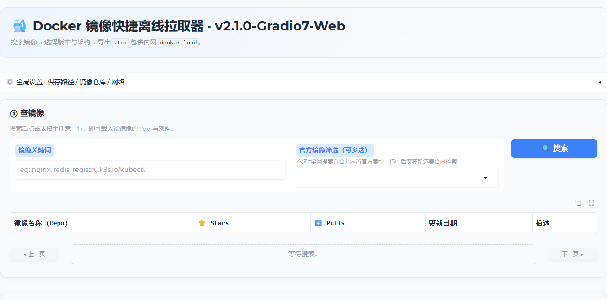
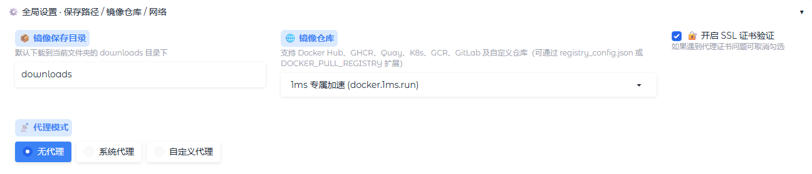
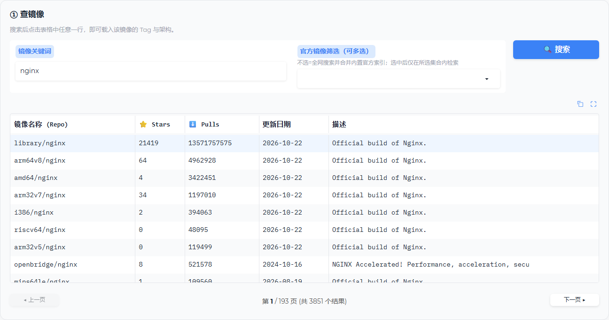
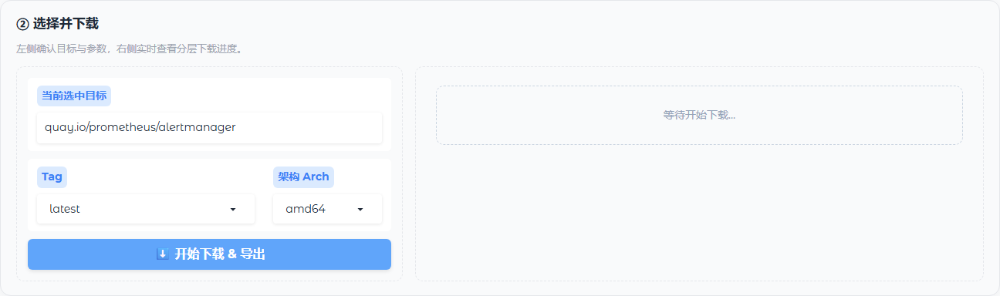
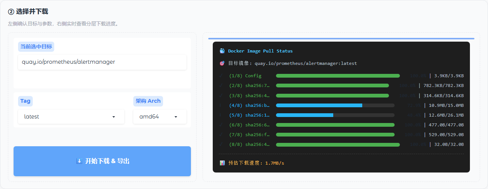
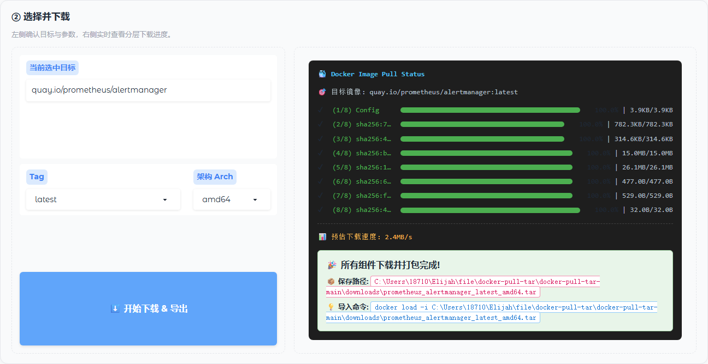
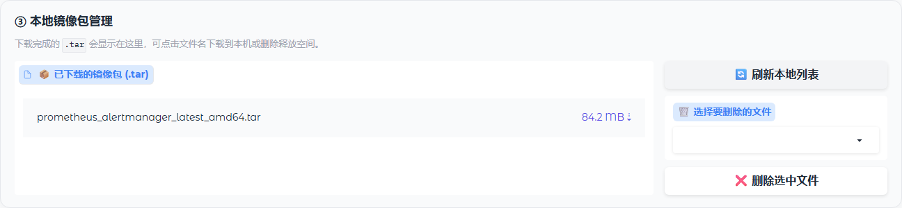

# Docker 镜像离线拉取器（B/S 优化版）


一个基于浏览器/服务器（Browser/Server）架构的本地镜像拉取工具：在本机启动 Web 服务，通过浏览器完成镜像搜索、Tag 与架构选择、分层下载，并导出可直接 `docker load` 的 `.tar` 镜像包。

> **项目来源**：本项目来源于 GitHub 开源项目 [topcss/docker-pull-tar](https://github.com/topcss/docker-pull-tar)，是在其基础上完成二次优化的衍生版本，与上游项目无隶属关系。原项目采用 MIT 许可证。

**当前版本**：`v2.1.0-Gradio7-Web`（版本号为项目自命名，实际运行在 Gradio 6.x 上）

---

## 文档导航

| 文档 | 内容 |
| --- | --- |
| [README.md](./README.md) | 项目介绍、环境要求、部署步骤、使用说明、常见问题 |
| [CONTRIBUTING.md](./CONTRIBUTING.md) | 开发环境、编码规范、提交规范、PR 检查清单 |
| [CHANGELOG.md](./CHANGELOG.md) | 版本变更记录与后续计划 |
| [.env.example](./.env.example) | 环境变量清单与取值示例 |
| [registry_config.example.json](./registry_config.example.json) | 自定义镜像仓库配置模板 |
| [LICENSE](./LICENSE) | MIT 许可证 |

---

## 目录

- [一、项目概述](#一项目概述)
- [二、核心特性说明](#二核心特性说明)
- [三、本地环境要求](#三本地环境要求)
- [四、B/S 部署步骤](#四bs-部署步骤)
- [五、启动运行指南](#五启动运行指南)
- [六、优化变更说明](#六优化变更说明)
- [七、功能使用说明](#七功能使用说明)
- [八、项目结构](#八项目结构)
- [九、测试](#九测试)
- [十、已知限制与后续计划](#十已知限制与后续计划)
- [十一、常见问题排查](#十一常见问题排查)
- [十二、贡献指南](#十二贡献指南)
- [十三、许可证与致谢](#十三许可证与致谢)

---

## 一、项目概述

Docker 镜像离线拉取器面向**内网、离线或无法直连镜像仓库**的场景。它不依赖本机 Docker 守护进程，而是直接调用 Docker Registry HTTP API v2 完成镜像清单解析与分层下载，最终打包为标准镜像 tar 文件，复制到目标机器后即可导入。

本项目在原项目基础上完成了产品形态与界面的整体重构：

- **完全移除客户端支持**：不再提供命令行客户端、1ms 专版客户端及单文件 EXE 交付形态，仓库中不保留任何客户端入口。
- **仅支持本地 B/S 架构**：唯一正式运行方式为“本地启动 Web 服务 + 浏览器访问”，服务与浏览器可运行在同一台机器，也可在同一可信内网内跨机访问。
- **全界面重新优化**：基于 Gradio 6 重构页面布局、样式与交互流程，采用三步式操作面板、响应式布局、实时分层进度面板与内置文件管理。

项目当前形态：

| 项目属性 | 说明 |
| --- | --- |
| 运行架构 | 本地 B/S（Browser/Server） |
| 服务入口 | `app.py` |
| 默认监听 | `0.0.0.0:7860` |
| 访问方式 | 浏览器访问 `http://127.0.0.1:7860` |
| 应用版本 | `v2.1.0-Gradio7-Web` |
| 许可证 | MIT |

### 界面总览



页面自上而下依次为：标题区、全局设置（默认收起）、① 查镜像、② 选择并下载、③ 本地镜像包管理。主流程按序号推进，上一区域的选中结果会自动驱动下一区域。

### 与原项目的核心差异

| 维度 | 原项目 | 当前 B/S 优化版 |
| --- | --- | --- |
| 交付形态 | 命令行脚本、1ms 专版客户端、Web 界面、PyInstaller EXE | **仅保留 Web 服务**，客户端与 EXE 打包全部移除 |
| 运行方式 | 本机命令行 / EXE / Web | **仅本地 B/S**：启动服务后由浏览器操作 |
| 依赖范围 | 客户端与 Web 混合依赖 | 仅 Web 运行依赖，已移除客户端专用依赖 |
| 页面布局 | 原版界面结构 | **全新三步式布局 + 响应式设计 + 统一视觉样式** |
| 仓库支持 | Docker Hub 为主 | 多仓库配置、连通性预检查、OCI 清单兼容 |
| 搜索体验 | 基础检索 | 在线索引 + 内置清单、分页、官方分组多选、精确匹配置顶 |
| 产品文件管理 | 无 | 内置 tar 列表、浏览器下载、删除 |
| 测试范围 | 含客户端测试 | 聚焦 Web 拉取链路、配置、搜索与连通性 |

---

## 二、核心特性说明

### 2.1 产品形态

- **纯本地 B/S**：无需桌面客户端，Python 环境启动服务后即可使用；关闭服务即停止。
- **零 Docker 依赖**：生成镜像包的机器无需安装 Docker，只有导入产物的目标机器需要 Docker。
- **单页三步流程**：查镜像 → 选 Tag/架构与仓库 → 下载并管理产物，页面结构固定、路径清晰。
- **局域网可用**：默认监听 `0.0.0.0`，同一内网的其他设备可通过服务器 IP 访问；无需额外前端构建。

### 2.2 镜像获取能力

- **多镜像仓库**：内置 Docker Hub、GHCR、Quay、registry.k8s.io、k8s.gcr.io、GCR、GitLab，以及 1ms、南京大学等加速源；支持通过配置文件扩展私有仓库。
- **仓库连通性预检查**：下载前访问 `https://<registry>/v2/`，对超时、DNS/网络不可达、SSL 握手失败、非 Registry 服务等情况给出明确错误。
- **Docker / OCI 清单兼容**：清单请求同时声明 Docker 与 OCI 媒体类型，可正确处理 GHCR 上仅提供 OCI 清单的镜像（如 `ghcr.io/kite-org/kite`）。
- **多架构选择**：支持 `amd64`、`arm64`、`arm/v7`、`s390x`、`ppc64le`；读取 manifest list 后按所选架构匹配（`arm/v7` 会同时校验 `architecture=arm` 与 `variant=v7`），不存在的架构会直接提示。
- **分层并行下载**：最多 8 层同时下载，单层失败最多尝试 4 次（首次 + 3 次重试，退避间隔逐次递增）。
- **断点续传**：目标文件已存在时通过 HTTP `Range` 从已有大小处继续；服务重启后重新点击下载同一镜像可继续使用已下载的分块文件。若服务端忽略 `Range` 返回 200，则从零覆盖写入，避免重复数据损坏镜像层。
- **匿名访问公开仓库**：自动处理 `WWW-Authenticate` 并获取匿名 Bearer Token，适配公开镜像仓库。
- **进度可视化**：实时展示每一层的完成百分比、已下载/总大小与整体速度。

### 2.3 搜索与筛选

- **双数据源**：优先请求 1ms 在线索引；在线不可用时降级为内置官方镜像清单。未勾选分组时，离线结果只包含带仓库前缀的内置条目与精确匹配项；勾选「官方镜像筛选」后可检索全部 48 条内置清单。
- **内置官方清单**：7 个分组、共 48 条常用镜像，支持多选筛选。
- **分组筛选**：Docker 官方（12）、GitHub 官方（7）、Quay 官方（6）、Kubernetes 官方（9）、Kubernetes 旧版（5）、Google 官方（6）、GitLab 官方（3）。
- **精确匹配优先**：输入完整仓库名时，精确结果置顶展示；Docker Hub 未收录时自动匿名探测 GHCR 同名公开仓库。
- **分页浏览**：在线结果每页 20 条，上一页/下一页切换时保留关键词与筛选条件；第 1 页会额外并入内置清单与精确匹配结果，因此可能多于 20 条。
- **Tag 自动加载**：非 Docker Hub 镜像直接读取目标仓库 `tags/list`，过滤 `sha256-*.sig` 等签名标签；返回的 Tag 超过 100 条时按语义版本倒序重排，否则保持仓库返回顺序。Docker Hub 镜像通过 1ms 标签接口获取；异常时回退为 `latest`。

### 2.4 界面与交互

- **统一视觉风格**：自定义 CSS 变量与页面样式，蓝色主题，卡片化面板与清晰的层级标题。
- **响应式布局**：针对桌面、平板与手机设置断点，窄屏下设置区与操作区自动纵向排列。
- **全局设置折叠区**：保存目录、镜像仓库、SSL 校验、代理模式集中管理，默认收起，减少主流程干扰。
- **实时进度面板**：深色终端风格面板，逐层进度条、层状态图标、完成提示与错误提示。
- **本地文件管理**：自动列出输出目录中的 `.tar`，支持浏览器直接下载到本机与删除。

### 2.5 部署与配置

- **配置优先级**：界面选择 > 环境变量 > 配置文件 > 内置默认值。
- **环境变量**：`DOCKER_PULL_REGISTRY`、`DOCKER_PULL_CONFIG_FILE`。
- **代理支持**：无代理、系统代理、自定义代理（含账号密码）三种模式。代理仅作用于本工具创建的 HTTP 会话，不改写进程级 `HTTP_PROXY` / `NO_PROXY` 环境变量，因此不会影响同机其它程序；选择「无代理」时也不会读取系统代理变量。
- **SSL 校验开关**：默认开启证书校验；在使用自签证书代理等特殊环境时可关闭。

---

## 三、本地环境要求

| 项目 | 最低要求 | 推荐/已验证 |
| --- | --- | --- |
| 操作系统 | Windows / Linux / macOS | Windows 11（已实际验证） |
| Python | 3.10 | 3.13.11（已验证） |
| Web 框架 | Gradio >= 6.14.0 | 6.31.0（已验证） |
| Python 依赖 | `requirements.txt` | 见下方依赖清单 |
| 浏览器 | Chrome / Edge / Firefox 近期版本 | Edge 或 Chrome |
| 磁盘空间 | 按目标镜像大小预留，建议 2 倍余量 | 视镜像而定 |
| 网络 | 可访问目标镜像仓库与 `1ms.run` | 内网需配置代理或加速源 |
| 空闲端口 | 7860 | 可修改 |

**依赖清单（`requirements.txt`）**

```text
# 运行依赖（Web 服务）；测试依赖见 requirements-dev.txt
requests>=2.32.4     # < 2.32.4 存在已公开漏洞（CVE-2024-47081）
urllib3>=2.5.0       # < 2.5.0 存在已公开漏洞（CVE-2025-50181）
gradio>=6.14.0
```

测试与开发额外需要 `pytest>=8.0.0`，由 `requirements-dev.txt` 统一提供（内容为 `-r requirements.txt` 加 pytest）。

依赖采用**下限约束**而非精确锁定：既避免落入存在漏洞的旧版本，也避免与 Gradio 自身的传递依赖产生冲突。需要完全可复现的环境时，可自行 `pip freeze > requirements.lock.txt`。

本项目为纯 Python 项目：运行依赖由 `requirements.txt` 管理，开发依赖由 `requirements-dev.txt` 管理，测试配置由 `pyproject.toml` 管理，**不存在 `package.json`、npm 构建或前端打包步骤**。

**环境自检**

```bash
python --version          # 需为 3.10 及以上
python -m pip --version
```

> Windows 下若 `python` 指向的是 Microsoft Store 占位程序，请改用已安装的 Python 完整路径，或通过 `py -3.13` 调用。

---

## 四、B/S 部署步骤

以下步骤适用于 Windows 与 Linux/macOS。服务端只需 Python 环境，无需 Node.js、无需前端构建、无需 Docker。

### 4.1 获取源码

```bash
git clone <本仓库地址>
cd docker-pull-tar-main
```

也可直接下载 ZIP 解压后进入项目根目录。

### 4.2 创建并激活虚拟环境

**Windows（PowerShell）**

```powershell
python -m venv .venv
.\.venv\Scripts\Activate.ps1
```

若提示脚本执行被禁止，可仅本次会话放行：

```powershell
Set-ExecutionPolicy -Scope Process -ExecutionPolicy Bypass
```

**Linux / macOS**

```bash
python3 -m venv .venv
source .venv/bin/activate
```

### 4.3 安装依赖

```bash
python -m pip install --upgrade pip
pip install -r requirements.txt
```

国内网络环境下载缓慢时，可临时指定镜像源：

```bash
pip install -r requirements.txt -i https://pypi.tuna.tsinghua.edu.cn/simple
```

安装完成后验证：

```bash
python -c "import gradio, requests; print('gradio', gradio.__version__, '| requests', requests.__version__)"
```

仅需运行服务时安装到这里即可。如需执行单元测试，额外安装开发依赖：

```bash
pip install -r requirements-dev.txt
```

### 4.4 可选：配置镜像仓库

不配置时，Web 版默认使用 `docker.1ms.run` 加速源，页面顶部「镜像仓库」下拉框可随时切换。

在项目根目录创建 `registry_config.json`（可直接复制 [registry_config.example.json](./registry_config.example.json) 后修改）：

```json
{
  "default_registry": "ghcr",
  "registries": {
    "company": {"name": "公司内部镜像站", "host": "mirror.example.com"},
    "ghcr": {"name": "GitHub Container Registry", "host": "ghcr.io"}
  }
}
```

- `registries` 的值支持 `"host"` 字符串或 `{"name": ..., "host": ..., "description": ...}` 对象。
- `host` 只填主机名（可含端口），不要带 `https://` 前缀或路径。
- 与内置预置项同名（如 `ghcr`）时，以配置文件中的地址为准。
- `default_registry` 填写的别名必须存在于 `registries` 或内置预置项中；若无法识别，启动时会输出 `RuntimeWarning` 并回退到内置默认仓库，不会导致启动失败。
- 使用其它路径的配置文件：设置 `DOCKER_PULL_CONFIG_FILE`；只想临时切换默认仓库：设置 `DOCKER_PULL_REGISTRY`。

环境变量清单见 [.env.example](./.env.example)（该文件仅作模板，项目不会自动加载 `.env`），在启动前按 Shell 语法设置：

```powershell
# Windows PowerShell
$env:DOCKER_PULL_REGISTRY = "quay"
$env:DOCKER_PULL_CONFIG_FILE = ".\registry_config.json"
```

```bash
# Linux / macOS
export DOCKER_PULL_REGISTRY=quay
export DOCKER_PULL_CONFIG_FILE=./registry_config.json
```

配置优先级从高到低：**界面选择 > 环境变量 > 配置文件 > 内置默认值**。

内置预置仓库：

| 别名 | 名称 | 地址 |
| --- | --- | --- |
| `docker` | Docker Hub (官方) | `registry-1.docker.io` |
| `ghcr` | GitHub Container Registry | `ghcr.io` |
| `quay` | Quay.io | `quay.io` |
| `k8s` | Kubernetes 官方镜像 | `registry.k8s.io` |
| `k8s-gcr` | Kubernetes 旧版镜像 | `k8s.gcr.io` |
| `gcr` | Google Container Registry | `gcr.io` |
| `gitlab` | GitLab Container Registry | `registry.gitlab.com` |
| `mirror-1ms` | 1ms 专属加速 | `docker.1ms.run` |
| `mirror-nju` | 国内源: 南大 | `docker.nju.edu.cn` |

### 4.5 启动服务

```bash
python app.py
```

预期输出：

```text
服务启动中...
请在浏览器访问下方 URL 打开 UI 界面。
Running on local URL:  http://127.0.0.1:7860
```

服务启动时 `inbrowser=True` 会尝试自动打开默认浏览器；在无图形界面的服务器上该动作可能被忽略，不影响服务运行。

### 4.6 验证部署

```bash
# 浏览器访问
http://127.0.0.1:7860
```

命令行验证：

```bash
curl -I http://127.0.0.1:7860
```

```powershell
# Windows PowerShell
Invoke-WebRequest -Uri http://127.0.0.1:7860 -Method Head
```

返回 HTTP 200 即表示服务已正常监听。

### 4.7 局域网访问

服务默认监听 `0.0.0.0`，同一内网设备可通过服务器 IP 访问：

```text
http://<服务器局域网IP>:7860
```

Windows 需在防火墙中放行 7860 端口（管理员 PowerShell）：

```powershell
New-NetFirewallRule -DisplayName "Docker Puller 7860" -Direction Inbound -Protocol TCP -LocalPort 7860 -Action Allow
```

Linux 请根据所用防火墙工具（`ufw`、`firewalld`）放行对应端口。

> 页面没有内置登录鉴权，请仅在可信内网使用；如需跨网络访问，应在前置反向代理上增加 HTTPS 与访问控制。

### 4.8 修改监听地址或端口

编辑 [app.py](./app.py) 末尾的启动参数：

```python
demo.launch(
    server_name="0.0.0.0",   # 仅本机使用可改为 127.0.0.1
    server_port=7860,         # 按需修改端口
    inbrowser=True,
    theme=gr.themes.Soft(primary_hue="blue"),
    css=CUSTOM_CSS,
    favicon_path=str(favicon_path) if favicon_path.exists() else None
)
```

修改 `server_port` 会同时改变控制台输出的访问地址。若端口被占用，请参考[常见问题排查](#十一常见问题排查)。

### 4.9 停止与后台运行

- **停止**：在运行服务的终端按 `Ctrl+C`。
- **Linux/macOS 后台运行**：

```bash
nohup python app.py > app.log 2>&1 &
```

- **Windows 后台运行**：可新开 PowerShell 窗口执行启动命令，或使用任务计划程序；日志输出在启动窗口或重定向文件中。

---

## 五、启动运行指南

1. **启动服务**：激活虚拟环境后执行 `python app.py`，确认控制台出现访问地址且无异常堆栈。
2. **打开页面**：浏览器访问 `http://127.0.0.1:7860`，确认页面标题与三步式布局正常加载（对照[页面首屏](./screenshots/01-overview.png)）。
3. **选择全局设置**（可选）：展开「全局设置」，确认镜像保存目录（默认 `downloads`）、镜像仓库、SSL 校验与代理模式（对照[全局设置](./screenshots/02-settings.png)）。
4. **搜索镜像**：在第一步输入关键词，得到结果表格；点击目标行后，第二步会显示当前选中镜像并自动加载 Tag（对照[搜索结果](./screenshots/03-search.png)）。
5. **确认参数**：选择 Tag 与架构，第二步会显示「当前选中目标」的仓库路径；完整镜像地址与下载进度在点击下载后于进度面板显示（对照[选择参数](./screenshots/04-select-params.png)）。
6. **开始下载**：点击「开始下载 & 导出」，观察实时进度；完成后页面提示产物路径，第三步文件列表自动刷新（对照[下载进度](./screenshots/05-progress.png)与[下载完成](./screenshots/06-download-done.png)）。
7. **导入镜像**：将 `.tar` 复制到目标机器执行 `docker load -i <文件>`。

启动成功的判定标准：控制台输出访问地址、页面标题显示 `v2.1.0-Gradio7-Web`、三步面板与底部页脚完整显示且无红色错误条。

停止使用：关闭浏览器标签不会停止服务；需在终端 `Ctrl+C` 结束进程。再次启动后页面状态会重置，已下载的 tar 仍保留在输出目录中。

---

## 六、优化变更说明

本节记录当前 B/S 优化版相对原项目的实际改动，便于后续维护与版本追溯。

### 6.1 交付形态调整

- 删除命令行脚本与 1ms 专版客户端入口，项目不再提供终端交互式拉取方式。
- 删除 PyInstaller 打包脚本、EXE 版本资源、构建清理脚本与打包说明文档，不再分发单文件可执行程序。
- 删除对应的客户端单元测试，测试范围收敛到 Web 服务链路。
- 移除仅客户端使用的 `tqdm` 依赖，`requirements.txt` 仅保留 Web 运行所需依赖。
- 当前唯一入口为 `python app.py`，运行形态固定为本地 B/S。

### 6.2 界面重构

- 采用新的页面骨架：标题区、全局设置折叠区、三步式主流程面板、文件管理面板。
- 统一配色、圆角、阴影、间距与按钮层级，主操作使用主色按钮突出。
- 增加 `1200px`、`768px` 两档响应式断点，宽屏双列、窄屏单列。
- 进度区域改为深色面板，逐层状态图标、百分比、大小与速度信息分区展示。
- 修正进度行右侧「百分比 | 已下载/总大小」在长文本下被裁切的问题，改为按内容宽度自适应。
- 搜索区、参数区、下载区、文件区使用独立卡片，空状态与错误提示更明确。

### 6.3 功能增强

- 增加多仓库配置与环境变量支持，界面可直接切换预置仓库与自定义仓库。
- 下载前增加仓库连通性预检查，错误信息区分超时、网络不可达、SSL 失败与非法 Registry。
- 清单请求补充 OCI 媒体类型，解决 GHCR 纯 OCI 镜像返回 404 的问题。
- 增加官方镜像分组多选筛选（7 组 48 条）与筛选范围内的分页检索。
- 增加精确匹配置顶与 GHCR 同名仓库探测。
- Web 端 Tag 改为直接读取目标仓库 `tags/list`，过滤签名标签并按语义版本排序。
- 增加无代理/系统代理/自定义代理三种模式与 SSL 校验开关。
- 增加本地 tar 文件列表、浏览器下载与删除能力。
- 分层下载支持最多 8 层并行与 4 次重试，进度面板实时刷新。

### 6.4 工程化调整

- 保留并扩充 `tests/` 测试集，覆盖配置解析、地址重写、连通性检查、搜索、拉取流程与真实仓库集成测试。
- 依赖拆分为 `requirements.txt`（运行）与 `requirements-dev.txt`（开发/测试）。
- 最近一次本地测试结果：**176 通过、13 跳过**（未开启真实网络集成测试）。

---

## 七、功能使用说明

### 7.1 页面结构


| 区域 | 作用 | 关键元素 |
| --- | --- | --- |
| 标题区 | 显示应用名称、当前版本与一句话说明 | 标题、版本号、流程说明 |
| 全局设置（可折叠） | 保存目录、镜像仓库、SSL 校验、代理模式与代理地址 | 目录输入框、仓库下拉框、SSL 复选框、代理单选 |
| ① 查镜像 | 关键词搜索、官方镜像分组筛选、分页、结果表格 | 关键词框、筛选下拉、搜索按钮、结果表、翻页 |
| ② 选择并下载 | 当前选中镜像、Tag、架构确认与实时进度 | 选中目标、Tag/架构下拉、下载按钮、进度面板 |
| ③ 本地镜像包管理 | 输出目录 tar 列表、刷新、下载、删除 | 文件列表、刷新按钮、删除下拉与按钮 |

三个步骤面板之间是联动关系：①中点击的表格行决定②的当前目标，②下载完成后自动刷新③的文件列表。

### 7.2 全局设置



| 设置项 | 默认值 | 说明 |
| --- | --- | --- |
| 镜像保存目录 | `downloads` | 相对启动服务时的当前工作目录（在项目根目录执行 `python app.py` 时即项目根目录）；不存在会自动创建；产物 tar 直接写入该目录 |
| 镜像仓库 | `1ms 专属加速 (docker.1ms.run)`（未配置时） | 下拉选择预置仓库或配置中的自定义仓库；对不含仓库前缀的镜像生效 |
| 开启 SSL 证书验证 | 勾选 | 代理使用自签证书、企业证书或证书链异常时可取消勾选 |
| 代理模式 | 无代理 | 可选「系统代理」或「自定义代理」；自定义模式支持 `host:port` 与用户名密码 |

展开方式：点击「⚙️ 全局设置 · 保存路径 / 镜像仓库 / 网络」标题栏。设置默认收起，避免干扰主流程；修改后立即对后续搜索、Tag 加载与下载生效。

### 7.3 搜索镜像



1. 在「镜像关键词」输入镜像名，例如 `nginx`、`redis`、`k8s`、`ghcr.io/kite-org/kite`。
2. 点击「🔍 搜索」。结果表依次展示镜像名称（Repo）、Stars、Pulls、更新日期、描述。
3. 需要限定范围时，在「官方镜像筛选」中多选分组；选中后仅在该集合内检索，翻页不会丢失条件。
4. 点击结果表中任意一行，该行镜像会被带入「② 选择并下载」。

说明：

- 搜索框输入后需点击「搜索」按钮触发，回车不会提交。
- 结果表头部右侧提供复制数据与全屏按钮，便于查看较宽的列。
- 在线索引主要覆盖 Docker Hub；GHCR、Quay 等仓库的镜像建议输入完整仓库引用，或从内置官方清单中选择。
- 在线索引不可用时，页面会退化为内置清单检索：未勾选分组时只匹配带仓库前缀的内置条目与精确镜像名，勾选「官方镜像筛选」后可检索全部 48 条内置清单。
- 输入完整仓库名（含 `/` 或已知仓库前缀）时会优先按精确匹配处理，并将结果置顶；Docker Hub 未收录时自动探测 GHCR 同名公开仓库。
- 每页 20 条，底部显示「第 x / y 页（共 n 个结果）」，翻页复用当前关键词与筛选条件。

### 7.4 选择 Tag 与架构



- **当前选中目标**：显示点击的镜像仓库路径，只读；若带仓库前缀（如 `ghcr.io/...`、`quay.io/...`），下载时优先使用该前缀。
- **Tag**：点击结果行后自动加载目标仓库的标签列表并过滤签名标签；返回标签超过 100 条时按语义版本倒序重排，否则保持仓库返回顺序；加载失败时仅保留 `latest`。
- **架构**：`amd64`（默认）、`arm64`、`arm/v7`、`s390x`、`ppc64le`。
- **开始下载 & 导出**：未选择镜像时点击会提示先在表格中选择一行。

镜像地址补全规则：

| 输入镜像 | 当前仓库 | 实际拉取地址 |
| --- | --- | --- |
| `nginx:latest` | `ghcr.io` | `ghcr.io/library/nginx:latest` |
| `nginx:latest` | 未指定 | `registry-1.docker.io/library/nginx:latest` |
| `docker.io/library/nginx:latest` | `quay.io` | `docker.io/library/nginx:latest`（保留自带仓库前缀） |
| `ghcr.io/foo/bar:1.0` | 任意 | `ghcr.io/foo/bar:1.0`（保留自带仓库） |

只有 Docker Hub（含 1ms、南大等 Hub 加速源）的单段镜像名才会补全 `library/`；`registry.k8s.io/pause` 这类目标仓库路径结构不同的镜像，单段名保持原样，不会补 `library/`。

### 7.5 下载与产物

点击「开始下载 & 导出」后，服务端依次执行：连通性检查 → 获取匿名 Token → 读取清单并匹配架构 → 下载 Config 与各层 → 解压并组装 → 打包 tar。中间层目录会保留在输出目录中，便于失败后断点续传，可手动删除。

下载中的进度面板：



- 第一行显示实际拉取地址，可用于核对仓库前缀与 Tag 是否正确。
- 每一层单独一行，包含序号（如 `2/8`）、层摘要前 12 位、进度条、百分比与「已下载/总大小」。
- 状态图标：`⏳` 等待、`⬇` 下载中、`✔` 已完成；下载中的层使用蓝色进度条，完成的层使用绿色。
- 底部实时显示整体下载速度；多层的并行下载会同时推进多条进度条。

完成后的进度面板：



- 全部完成后显示「🎉 所有组件下载并打包完成！」，并给出保存路径与可直接执行的 `docker load -i` 命令。
- 出现错误时，面板替换为红色错误提示，内容为服务端返回的具体原因（如 401、404、超时）。

产物路径：

```text
downloads/
└── prometheus_alertmanager_latest_amd64.tar
```

命名规则为 `<仓库路径>_<tag>_<架构>`，其中仓库路径中的 `/` 替换为 `_`。下载过程中使用的 `<同名目录>/layers/` 为中间文件，打包完成后会被清理。

导入目标机器：

```bash
docker load -i prometheus_alertmanager_latest_amd64.tar
docker images
```

说明：Web 版写入镜像的 `RepoTags` 使用完整仓库路径，例如 `library/nginx:latest`、`kite-org/kite:v0.15.1`。若导入后需要保留镜像仓库前缀，可补充 tag：

```bash
docker tag kite-org/kite:v0.15.1 ghcr.io/kite-org/kite:v0.15.1
```

### 7.6 本地镜像包管理



- 列表显示输出目录中的 `.tar` 文件名与大小，例如 `prometheus_alertmanager_latest_amd64.tar 84.2 MB`。
- 点击「🔄 刷新本地列表」重新扫描目录；下载完成后页面也会自动刷新。
- 点击文件名即可通过浏览器把 tar 下载到本机。
- 在「🗑️ 选择要删除的文件」中选择文件名后点击「❌ 删除选中文件」，会直接删除服务器输出目录中的对应文件，操作不可撤销。

### 7.7 代理与 SSL

- **系统代理**：读取操作系统代理设置。
- **自定义代理**：填写 `host:port`，如 `127.0.0.1:7890`；支持用户名与密码。
- 代理只对本工具发起的请求生效，不会修改进程的 `HTTP_PROXY` / `NO_PROXY` 等环境变量；选择「无代理」时也不会复用系统代理。
- 关闭 SSL 校验会降低传输安全性，仅在明确知道代理证书问题时使用。

---

## 八、项目结构

```text
docker-pull-tar-main/
├── app.py                            # 唯一运行入口：Gradio Web 服务、拉取逻辑、搜索与文件管理
├── registry_config.py                # 仓库配置加载、地址解析与前缀替换、连通性预检查
├── official_images.py                # 7 组官方镜像清单与本地检索、分页常量
├── requirements.txt                  # Web 运行依赖
├── requirements-dev.txt              # 开发/测试依赖（pytest）
├── pyproject.toml                    # pytest 等工具配置
├── README.md                         # 项目说明：部署、使用、排查
├── CONTRIBUTING.md                   # 贡献指南：开发环境、编码与提交规范
├── CHANGELOG.md                      # 版本变更记录
├── LICENSE                           # MIT 许可证
├── .env.example                      # 环境变量清单模板
├── registry_config.example.json      # 自定义仓库配置模板
├── .editorconfig                     # 编辑器缩进与编码约定
├── .gitignore                        # 忽略规则：产物、缓存、本地配置
├── favicon.ico                       # 浏览器页签图标
├── downloads/                        # 默认镜像输出目录（产物不入库，仅保留 .gitkeep）
├── screenshots/                      # 本文档使用的界面截图
└── tests/                            # pytest 测试集
    ├── conftest.py                   # 环境变量隔离与公共 fixture
    ├── fakes.py                      # 伪造 Registry 响应与会话
    ├── test_connectivity.py          # 连通性预检查
    ├── test_image_reference.py       # 镜像地址解析与重写
    ├── test_integration_registries.py  # 真实仓库集成测试（默认跳过）
    ├── test_official_images.py       # 内置清单与检索
    ├── test_pull_flow.py             # Web 拉取链路（依赖 Gradio）
    ├── test_registry_config.py       # 配置加载与优先级
    └── test_search.py                # 搜索、分页与精确匹配
```

配置文件说明：

| 文件 | 是否入库 | 用途 |
| --- | --- | --- |
| `registry_config.example.json` | 是 | 仓库配置模板，复制为 `registry_config.json` 后修改 |
| `registry_config.json` | 否 | 本地仓库配置，可能包含内网地址 |
| `.env.example` | 是 | 环境变量清单模板，不自动加载，仅作设置参考 |
| `pyproject.toml` | 是 | pytest 测试路径与告警过滤配置 |

模块职责：

| 模块 | 职责 |
| --- | --- |
| `app.py` | 页面构建、事件绑定、下载执行器、进度展示、Tag 获取、文件管理 |
| `registry_config.py` | 预置仓库、配置解析、环境变量优先级、镜像引用重写、`/v2/` 连通性检查 |
| `official_images.py` | 官方镜像分组数据、精确/模糊检索、分组归一化、默认分页大小 |

运行过程中会生成 `.venv/`、`__pycache__/`、`.pytest_cache/` 等本地目录，不属于源码内容。

---

## 九、测试

在项目根目录、已激活虚拟环境下执行：

```bash
python -m pytest tests -q
```

当前测试结果为 **176 通过、13 跳过**（跳过项为需要真实网络的集成测试）。

真实仓库集成测试默认关闭，需显式开启：

```powershell
# Windows PowerShell
$env:RUN_REGISTRY_INTEGRATION_TESTS = "1"
python -m pytest tests/test_integration_registries.py -q

$env:RUN_REGISTRY_PULL_TESTS = "1"
python -m pytest tests/test_integration_registries.py -k real_pull -q
```

```bash
# Linux / macOS
RUN_REGISTRY_INTEGRATION_TESTS=1 python -m pytest tests/test_integration_registries.py -q
RUN_REGISTRY_PULL_TESTS=1 python -m pytest tests/test_integration_registries.py -k real_pull -q
```

说明：

- `tests/test_pull_flow.py` 依赖 Gradio，未安装 Gradio 时会自动跳过。
- `tests/conftest.py` 会隔离 `DOCKER_PULL_REGISTRY` 与 `DOCKER_PULL_CONFIG_FILE`，避免本机环境影响测试结果。
- 集成测试会真实访问 GHCR、Quay、registry.k8s.io、k8s.gcr.io、gcr.io、GitLab 等仓库（`real_pull` 用例额外访问 Docker Hub），请在网络可用且允许外联的环境执行。

---

## 十、已知限制与后续计划

### 当前已知限制

- **无内置鉴权**：服务默认监听 `0.0.0.0` 且没有登录、权限或访问令牌机制，仅建议在可信内网使用。
- **不支持私有仓库凭据**：界面没有仓库账号密码输入，仅通过匿名 Token 访问公开仓库；需要登录的私有镜像无法在界面中直接拉取。
- **不支持 digest 引用**：`image@sha256:...` 形式不支持，需使用 Tag。
- **在线搜索仅覆盖 Docker Hub**：1ms 索引不包含 GHCR/Quay 等仓库；第三方仓库镜像需输入完整引用或从内置清单选择。
- **搜索与 Tag 依赖第三方接口**：Docker Hub 搜索与标签依赖 `1ms.run`，接口不可用时搜索降级为内置清单，Tag 回退为 `latest`。
- **无跨会话任务状态**：刷新页面会丢失搜索与下载进度；已有分块文件可继续下载，但页面不会恢复进度展示。
- **未做层 digest 校验**：当前 Web 下载流程未对层内容执行 SHA256 校验，仅依赖 Registry 传输与 HTTP 状态码。
- **架构选项固定**：界面仅提供 5 种常见架构；镜像若只提供其它架构，会提示未找到对应架构。
- **单进程服务**：队列并发上限为 4，单镜像层并行上限为 8；超大镜像的下载速度受网络与仓库限速影响。

### 后续计划

- 增加私有仓库认证（账号密码 / Token）。
- 增加层 SHA256 校验与下载完整性校验。
- 增加任务持久化与跨会话进度恢复。
- 扩展架构选项并支持按 manifest 动态生成。
- 增加配置文件的界面化管理与镜像站测速择优。
- 增加 HTTPS、访问鉴权与部署脚本，便于在受控内网中长期运行。
- 将下载目录限制在允许的根路径内，降低误写入风险。

> 以上为规划项，尚未在当前版本实现。

---

## 十一、常见问题排查

### 11.1 启动类问题

| 现象 | 常见原因 | 处理方式 |
| --- | --- | --- |
| `python: command not found` / 版本低于 3.10 | 未安装 Python 或未加入 PATH | 安装 Python 3.10+，或使用 `py -3.13 app.py` |
| `ModuleNotFoundError: gradio` | 依赖未安装或虚拟环境未激活 | 确认提示符带 `(.venv)` 后执行 `pip install -r requirements.txt` |
| `pip install` 超时 | 网络或代理问题 | 使用国内 PyPI 镜像，或配置 `HTTP_PROXY` / `HTTPS_PROXY` |
| `OSError: [Errno 98] Address already in use` / 端口占用 | 7860 已被其它进程占用 | 修改 `app.py` 的 `server_port`，或结束占用进程（见下） |
| Gradio 加载报错且版本过低 | Gradio 版本不满足 `>=6.14.0` | `pip install -U "gradio>=6.14.0"` 后重新启动 |
| 启动后提示无法自动打开浏览器 | 无图形界面或默认浏览器异常 | 忽略该提示，手动访问控制台输出的 URL |

Windows 查看与结束占用 7860 的进程：

```powershell
netstat -ano | findstr :7860
taskkill /PID <进程ID> /F
```

Linux/macOS：

```bash
lsof -i :7860
kill -9 <进程ID>
```

### 11.2 访问类问题

| 现象 | 常见原因 | 处理方式 |
| --- | --- | --- |
| 本机能打开，局域网设备打不开 | 防火墙未放行或使用了 `127.0.0.1` 监听 | 放行 7860；确认 `server_name="0.0.0.0"`；用服务器 IP 访问 |
| 页面白屏、样式错乱 | 浏览器缓存或 Gradio 版本不匹配 | 强制刷新（`Ctrl+F5`）；确认 Gradio 版本 |
| 页面能打开但按钮无响应 | 后端抛出异常或队列阻塞 | 查看启动终端堆栈；重启服务；减少并发任务 |
| 修改端口后无法访问 | 浏览器仍使用旧端口 | 使用控制台输出的新地址 |

### 11.3 搜索与 Tag 问题

| 现象 | 常见原因 | 处理方式 |
| --- | --- | --- |
| 搜索无结果 | 关键词不完整、在线索引不可用、代理拦截 | 换更通用的关键词；输入完整仓库名；检查代理；离线时使用内置清单 |
| 搜不到 GHCR/Quay 镜像 | 在线索引仅覆盖 Docker Hub | 输入完整引用（如 `ghcr.io/kite-org/kite`）或从「官方镜像筛选」中选择 |
| 点击结果后 Tag 为空或只有 `latest` | 标签接口异常、仓库限制访问 | 确认该镜像确有对应 Tag；检查网络与代理；手动选择 `latest` |
| 精确匹配未置顶 | 仓库名不完整或该仓库无同名镜像 | 输入含命名空间的完整名称后重试 |

### 11.4 下载失败问题

| 现象 | 常见原因 | 处理方式 |
| --- | --- | --- |
| 提示超时 / 网络不可达 | 无法访问目标仓库或代理配置错误 | 切换镜像站；在「全局设置」中配置代理后重试 |
| 提示 SSL 握手失败 | 代理证书、企业证书或系统时间异常 | 校正系统时间；必要时临时关闭「SSL 证书验证」 |
| 401 / 403 | 镜像为私有或需要登录 | 当前界面仅支持公开仓库，请改用可匿名访问的镜像源 |
| `MANIFEST_UNKNOWN` / 404 | Tag 不存在、仓库路径错误或纯 OCI 清单兼容问题 | 确认 Tag 与完整仓库名；换用其它 Tag；当前已声明 OCI 媒体类型 |
| 未找到对应架构 | 该 Tag 未提供所选架构 | 改选 `amd64` / `arm64` 等实际存在的架构 |
| 下载中断 | 网络抖动、页面关闭、服务停止 | 重新选择同一镜像与参数再次下载；已存在分块会尝试续传 |
| 磁盘写入失败 | 保存目录无权限或空间不足 | 更换保存目录；确认磁盘剩余空间 |

### 11.5 导入产物问题

| 现象 | 常见原因 | 处理方式 |
| --- | --- | --- |
| `docker load` 无输出或失败 | tar 不完整、文件损坏、Docker 服务异常 | 确认文件完整；重新下载；检查 `docker info` 是否正常 |
| 导入后镜像名不符预期 | `RepoTags` 使用完整仓库路径 | 使用 `docker images` 查看实际名称，必要时 `docker tag` 修正 |
| 导入后无法运行 | 架构与宿主机不匹配 | 重新按目标机器的 CPU 架构下载 |

### 11.6 离线环境说明

- 页面服务本身完全本地运行，断网时仍可打开并检索内置镜像清单。
- 在线搜索、Tag 获取与镜像下载需要访问外网；纯离线环境只能使用可访问的本地镜像仓库或已配置的代理/加速源。
- 首次部署需要安装 Python 依赖；完全离线部署可提前在有网络的机器上执行 `pip download -r requirements.txt -d wheels/`，再拷贝安装。

---

## 十二、贡献指南

完整开发环境、编码规范、提交规范与 PR 检查清单见 [CONTRIBUTING.md](./CONTRIBUTING.md)，版本变更记录见 [CHANGELOG.md](./CHANGELOG.md)。

要点：

1. 从主分支创建功能分支：`feature/xxx`、`fix/xxx`。
2. 保持提交聚焦，一个提交只做一件事；提交信息使用约定式前缀，如 `feat: 支持私有仓库认证`、`fix: 修复 Tag 加载失败`。
3. 遵循 PEP 8，与现有代码风格保持一致；新增公共函数请补充必要的文档字符串。
4. 新增或修改功能必须附带测试，覆盖正常流程与边界场景，并确保 `python -m pytest` 全部通过。
5. 不提交 `downloads/` 中的镜像产物、`*.tar`、虚拟环境、缓存目录与本地 `registry_config.json`（已在 `.gitignore` 中忽略）。
6. 提交 PR 时说明变更动机、影响范围与验证方式，并关联相关 Issue。
7. 本项目定位为纯本地 B/S 应用，不接受重新引入命令行客户端或 EXE 分发形态的变更。
8. 功能或行为变更需同步更新 README 对应章节，并在 CHANGELOG 的 `Unreleased` 下补充条目。

问题反馈与功能建议请提交 [GitHub Issues](https://github.com/topcss/docker-pull-tar/issues)。

---

## 十三、许可证与致谢

本项目采用 MIT 许可证，详情见 [LICENSE](./LICENSE)。

```text
MIT License
Copyright (c) 2025 Jack
```

感谢原项目作者及所有贡献者提供的开源基础。
